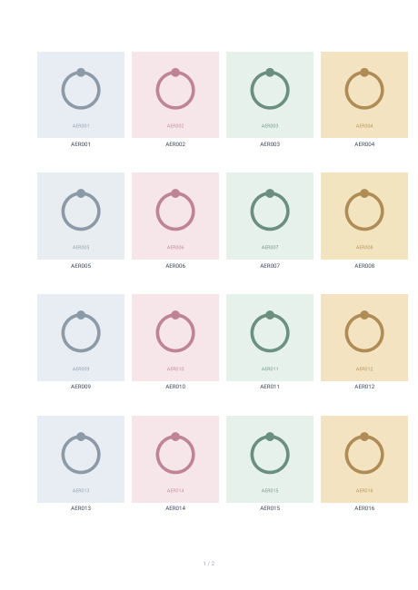

# Kuyum Studio

Kuyum Studio is a desktop application I built for jewellery wholesalers. A sales team can start with a folder of product photos, process a batch, and produce a catalogue that buyers can use to identify items by code. The same filename follows a product from its input photo to the caption in the PDF.

[Open the three-page sample catalogue](./sample-catalogue.pdf). It was exported by the application's own PDF service using 17 synthetic product illustrations. The first product page holds 16 items. The seventeenth moves to the next page with its code intact.

## Preparing the photographs

The operator selects the source and output folders and a material preset for sterling silver or steel. The desktop app reads JPEG, PNG and WebP, resizes the input and sends it to the image-processing service. Completed images are written as WebP with the original filename stem. For example, a file called `AER017.png` becomes `AER017.webp`.

A queue limits concurrent requests and exposes progress, pause, resume and cancel controls. Temporary errors can be retried. The batch report identifies individual files that failed so the operator can find them again.

## Building a buyer's catalogue

The operator selects images and supplies a title, with an optional subtitle and logo. The PDF builder prepares the images, retains their selected order and lays them out on numbered A4 product pages after a cover. Captions use the filenames without extensions. An unreadable image is recorded in the export report, and readable items can still be included.

Keeping captions attached to their images matters in a wholesale order. The buyer can ask for the code printed under the item, even after the team has converted its image format or added another page to the collection.

## Implementation and verification

The Windows desktop client uses Electron, React and TypeScript. The main process handles files, Sharp prepares images and pdfmake produces the document. A Fastify service handles the remote processing requests. PDF export can work from an existing folder of images.

For this showcase, the application's regression suites for image processing, catalogue layout and catalogue rules passed all **28 tests**. The sample was generated locally with the project's fixture generator and PDF service. Its three rendered pages and all 17 captions were checked. The preview illustrates catalogue layout using synthetic inputs.
